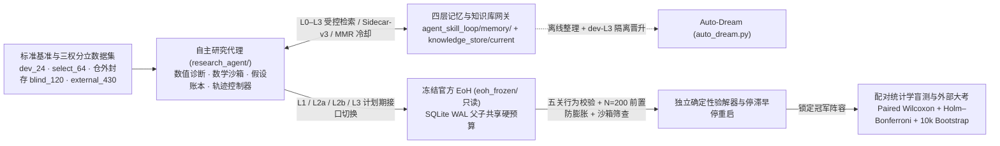

# auto-algo-opt

面向**组合优化自动启发式算法设计与演化**的自主研究代理工作台：将**自主数值诊断研究代理（`research_agent/`）**、**计划期分层接口设计**、**冻结官方 EoH 轮内演化（`eoh_frozen/`）**、**四层可审计记忆与闭环（M3.5）**、**进化轨迹自适应控制律（M5）**以及**仓外防泄漏盲测与持久化预算状态机**整合为端到端可复算科研工程系统。

项目通过 [algorithm-optimization Skill](skills/algorithm-optimization/SKILL.md) 为 Coding Agent 提供统一操作合同，配备不可变知识库发布指针（[`knowledge_store/current`](knowledge_store/current)）、离线四页研究工作台生成工具（[`frontend/build_dashboard.py`](frontend/build_dashboard.py)）以及大预算演化轨迹交互分析页（[`m32_evolution_trajectory.html`](experiments/milestone3_2/m32_evolution_trajectory.html)）。

---

## 核心架构与闭环流程



---

## 支持问题域与科研工程红线

| 问题域 | 当前支持契约与模板能力 | 关键约束与产出 |
|---|---|---|
| **CVRP**（带容量车辆路径） | 顺序构造、静态/动态并行合并、毁坏重建（Ruin-and-Recreate）及四层接口阶梯（`L1/L2a/L2b/L3`） | 同尺度严格对比，双口径披露 `exact-k` 与 `free_fleet`、`common_completed` 与 `overall` |
| **TSP**（旅行商问题） | 构造步进、引导插入 + 2-opt 精修接口 | `E(2)` 尺度不变性校验 + `TSPLIB 18` 外部对照 |
| **Online OBP**（在线一维装箱） | 在线优先度打分接口（`obp_online/v1`） | **严格前缀不变性**、零未来物品窥视、与离线 BPP 物理隔离 |
| **Offline BPP**（离线一维装箱） | 离线排序构造与重排精修接口（`bpp_offline/v1`） | 对比 `FFD` 确定性基线及 `BPPLib 70` 外部集合 |

**不可妥协的科研红线**：
1. **引擎与基准只读冻结**：`eoh_frozen/`、`benchmarks/eohs_v1/` 与所有历史发布快照 `knowledge_store/releases/*` 严禁就地篡改，[`knowledge_store/current`](knowledge_store/current) 保持 Git `120000` 符号链接。
2. **盲测三权分立与零泄漏**：`dev_24`、`select_64` 与盲测套件严格隔离，仓外保管签名与密钥（`.secrets/`）绝不入仓，仓库报告不泄露盲测原始坐标、需求或口令。
3. **非偏统计学检验**：`3–5` 颗随机种子的盲测结果**禁止混池伪扩大样本量**，一律按**逐种子配对（Paired Wilcoxon + Holm–Bonferroni 多重校正 + 10,000 次 Bootstrap 置信区间）**及 **共同完赛交集（`common_completed`）vs 全集（`overall`, 非完赛按 `2×` 惩罚）**双轨披露。

---

## 里程碑与全量实证全景（M1–M5 · M3.5 · Track 3）

### 演进路线概览

| 阶段 | 核心交付 | 代表性实证结论 | 报告与证据入口 |
|---|---|---|---|
| **M1 & M1.5** | 14 套三层基准（含 430 国际真题）、45 求解器、340+ 知识卡与离线工作台 | 建立可复算基线与历史规则双轨复现体系 | [知识库说明](docs/knowledge_base.md) · [报告索引](reports/README.md) |
| **M2 & M3.0** | 四层接口底盘、五关行为校验、`research_agent/` 与 SQLite WAL 共享预算 | `B_total=36` 下跨种子方差压缩 `>20` 倍；在 `EoH-S 256`（`+5.66%`）、`ABP 74`（`+4.06%`）、`Set X 100`（`+5.07%`）显著领先同协议规则 | [可靠性文档](docs/milestone2-reliability.md) · [接口编排](skills/algorithm-optimization/references/interface-design.md) |
| **M3.1（跨问题）** | `TSP`、`Online OBP`、`Offline BPP` 统一接入与 `blind_72` 盲测 | `tsp_l2` 显著优于 `tsp_nn_2opt`（`p_holm=0.040`）；在线/离线装箱分别逼平 `Best-Fit` 与 `FFD` | [M3.1 跨题报告](experiments/milestone3_1/m31_cross_problem_report.md) |
| **M3.2（大预算缩放）** | `36 -> 100 -> 200 -> 400` 请求曲线与单因子对照（21 格 + `blind_120`） | 揭示中小规模精度提升与 `n=200 @ 500ms` 延迟碰撞；`2000ms` 预算下全 3 种子零超时（最优 `22.9796` / `exact-k = 0.850`） | [M3.2 缩放报告](experiments/milestone3_2/m32_scaling_report.md) · [轨迹交互图](experiments/milestone3_2/m32_evolution_trajectory.html) |
| **M4（数学闭环）** | $2^5=32$ 精确 Shapley、HRK 径向下界 `R(I)`、$E(2)$ 不变性与 $\alpha=1$ 分岔 | 揭示“先远后近 × 随载重内旋”`+3.93%` 二阶强正协同；HRK 下界全库零违背 | [M4 Part 1](experiments/milestone4/m4_math_closure_part1.md) · [M4 Part 2](experiments/milestone4/m4_math_closure_part2.md) |
| **M5（轨迹控制 21 路）** | 自适应轨迹护栏、B4 内含子等价消融与 **21 路 Paratera 双模型盲测** | 120 题盲测显著领先历史控制 **`+12.93%–+25.14%`**；**`X-100` 大尺度完成率由历史 `0.130–0.180` 跃升至 `0.996`（4/5 种子 `100%` 满完赛）** | [M5 总报告](experiments/milestone5_paratera/m5_trajectory_control_report.md) · [M5 JSON](experiments/milestone5_paratera/m5_trajectory_control_report.json) |
| **M3.5（记忆闭环）** | L0–L3 四层记忆、`Sidecar-v3`、`antipattern`、MMR+冷却、`Auto-Dream` 与 12 格分叉消融 | `ABP-74` 全 3 种子 `Arm 3` 显著胜出无记忆 `Arm 0`（`+1.166%` / `+1.073%` / `+0.665%`, `p_holm ≤ 0.0128`）；合并后完成 Codex 终审与 L2/L3 门控修补（见下） | [M3.5 架构规范](docs/M3_5_MEMORY_SYSTEM_ARCHITECTURE.md) · [M3.5 消融报告](experiments/milestone3_5/m35_ablation_report.json) |
| **Track 3（顶会大考）** | **430 道国际真题 × 3 种子 × `500ms / 2000ms`** 全量横向对标 | 对齐 `PyVRP`、`VBS`/`SBS`、`AutoFolio`、`SATzilla`、`Hydra`、`ReEvo`、`EoH-S` | [s20261124 b500](experiments/baselines_2026/external_baselines_all_live_s20261124_b500.md) · [s20261124 b2000](experiments/baselines_2026/external_baselines_all_live_s20261124_b2000.md) |

### 重点一：M5 Paratera 21 路轨迹控制实证（`cvrp_m5_control_blind_120` & `CVRPLIB X-100`）

| 实验组（`500ms` 求解时限 / `100` 请求） | 种子数 | 120 题盲测惩罚均长 (`free_fleet comp` / `exact-k`) | `ABP-74` `free_fleet` 均长 | `X-100` `free_fleet` 完成率 | `X-100` `free_fleet` 惩罚均长 |
|---|---:|---:|---:|---:|---:|
| `legacy_baseline_500ms` (`DeepSeek-V4.1-Flash`) | 5 | `24.6404` (`1.000` / `0.583`) | `905.53` | `0.984` (`1/5` 满完赛) | `68,132.27` |
| `whitelist_latency_500ms` (`DeepSeek-V4.1-Flash`) | 5 | `24.6472` (`1.000` / **`0.650`**) | `907.06` | `0.988` (`2/5` 满完赛) | `67,668.56` |
| **`trajectory_ctrl_full_500ms` (`DeepSeek-V4.1-Flash`)** | 5 | `24.6979` (`1.000` / `0.582`) | `908.57` | **`0.996` (`4/5` 满完赛)** | **`66,744.03`**（前 4 种子 `66,284.5–66,383.5`） |
| `model2_legacy_500ms` (`Qwen4-Max`) | 3 | **`24.6097`** (`1.000` / `0.639`) | `903.32` | `0.977` | `69,053.50` |
| `model2_ctrl_full_500ms` (`Qwen4-Max`) | 3 | `27.2350` (`0.944` / `0.639`) | **`902.45`** | `0.443` | `103,258.37` |
| 历史对照：`l3_ctrl@500ms` / `m32_champion_pruned@500ms` | 1 | — | `910.34` / `896.93` | `0.180` / **`0.130`**（严重崩溃） | `120,654.30` / `123,216.91` |
| 人工基线：`cw_parallel_merge` / `cw_relocate_2opt` | 1 | — | `914.68` / `909.26` | `1.000` / `0.990` | `66,352.22` / `67,345.10` |

### 重点二：M3.5 四层记忆闭环 12 格分叉消融（Common-Start Fork）

在统一开发集起点、三颗随机种子（`20261124/25/26`）× 每格 `36` 请求（`DeepSeek-V4.1-Flash`）上：
- **`cvrp_ext_cvrplib_abp_74`（74/74 全完赛）**：`arm_m35_3_m35_full` 在全部 3 颗种子均统计显著优于无记忆 `arm_m35_0_m5_nomem`：**`+1.1657%`**（`53/9/12`, `p_holm=9e-8`）、**`+1.0726%`**（`48/6/20`, `p_holm=3.063e-4`）与 **`+0.6648%`**（`42/13/19`, `p_holm=0.01282`）；而朴素读记忆 `arm_m35_1_naive_mem` 存在跨种子退化（`s20261126` `0.0%`）。
- **`cvrp_ext_cvrplib_x_100`**：`arm_m35_3` 在 `common_completed` 2/3 种子显著胜出但伴随 5–6 例 `500ms` 超时；`arm_m35_2_m35_l12` 则保持 `100/100` 满完成率并在 `exact-k` 多项显著提升。
- **严谨口径说明**：首轮落盘 12 格数据完成于终审补丁（`690a2c36`）之前，彼时因未向 `best_generated` 导出 `parent_version_id`、且 `Arm 3` 共用 M4 基底库，实测反映的是“无记忆 vs 朴素记忆 vs 在线 `insight` 写回 vs 离线 `Auto-Dream` 快照”；上述在线 `solution` AST 绑定、隔离 `dev-L3` 知识库发布挂接及 `COMPLETED` 状态回归均已在 `690a2c36` 中经双模型审计修补并全绿通过。

### 重点三：Track 3 430 道国际真题 × 3 种子 × 双预算外部大考

| 算法（3 种子均值） | `eohs_256` `500ms` `free_fleet` (`exact-k`) Gap% | `ABP-74` `500ms` `free_fleet` (`exact-k`) Gap% | `X-100` `500ms` `free_fleet` 完成 / Gap% | `X-100` `2000ms` `free_fleet` 完成 / Gap% |
|---|---|---|---|---|
| **`PyVRP`**（C++ 编译上限） | **`1.199%`** (`6.849%`) | **`0.312%`** (`1.484%`) | **`100.0`** / **`4.027%`** | **`100.0`** / **`2.824%`** |
| `VBS`（后验组合上界） | `4.551%` (`6.919%`) | `3.039%` (`9.901%`) | `100.0` / `4.741%` | `100.0` / `4.339%` |
| `SBS`（单规则基线） | `5.201%` (`35.758%`) | `4.486%` (`29.802%`) | `96.3` / `11.037%` | `95.7` / `12.562%` |
| `AutoFolio` | `35.599%` (`38.215%`) | `3.098%` (`29.315%`) | `39.0` / `68.307%` | `95.7` / `12.562%` |
| `SATzilla` | `18.636%` (`34.769%`) | `4.267%` (`26.300%`) | `77.7` / `26.215%` | `98.7` / `8.987%` |
| `Hydra` | `18.099%` (`31.545%`) | `3.916%` (`40.961%`) | `77.0` / `29.374%` | `96.7` / `12.774%` |
| `EoH-S` (100 reqs live) | `5.485%` (`32.966%`) | `3.854%` (`30.481%`) | `88.3` / `27.139%` | `100.0` / `5.024%` |
| `ReEvo` (100 reqs live) | `42.829%` (`64.423%`) | `4.920%` (`37.206%`) | `12.3` / `94.656%` | `96.3` / `10.566%` |

---

## 快速开始与复现指南

### 1. 环境准备与零成本离线冒烟（Python 3.11）

Windows PowerShell 示例（Linux / WSL 请使用 `python3.11` 与 `.venv-co/bin/python`）：

```powershell
py -3.11 -m venv .venv-co
& .venv-co/Scripts/python.exe -m pip install -e ".[dev,eoh]"
& .venv-co/Scripts/python.exe -m agent_skill_loop smoke --problem cvrp_construct --output outputs/offline_smoke
```

该冒烟命令**完全离线、不触发付费 API**；重复执行请指定新的输出目录。

### 2. 在线模型配置与多任务实验调度

所有在线实验通过环境变量读取端点与密钥（参见 [`.env.example`](.env.example)，**严禁将任何密钥写入代码或提交入库**）：

- **运行 M5 轨迹控制矩阵**：[`tools/run_m5_trajectory_control.py`](tools/run_m5_trajectory_control.py)（支持 `emit-mux` / `run-one` / `lock-roster` / `unseal-blind` / `eval-external` / `report`）
- **运行 M3.5 四臂消融**：[`tools/run_m35_memory_ablation.py`](tools/run_m35_memory_ablation.py)（支持 `build-dev-seed` / `init-fork` / `emit-mux` / `run-arm` / `eval-select` / `eval-external` / `report`）
- **运行 Track 3 外部基线**：[`tools/run_external_baselines_2026.py`](tools/run_external_baselines_2026.py)（支持 `static`、`evolution` 与 `benchmark` 全流程）
- **并发任务调度器**：[`tools/multi_task_mux.py`](tools/multi_task_mux.py)（`start|status|tail|wait|kill`，按受限 API 并发度安全隔离多种子 SQLite WAL 预算与日志）

### 3. 核心测试与一致性校验命令

```powershell
py -3.11 -m pytest tests/test_m31_session_baseline.py tests/test_m35_memory_core.py tests/test_m35_ablation_and_dream.py tests/test_external_baselines_2026.py tests/test_m5_trajectory_control.py tests/test_m3_blind_protocols.py --basetemp=build/pytest-verify -q
py -3.11 tools/validate_skill.py skills/algorithm-optimization
py -3.11 -m knowledge_tools validate-release --release knowledge_store/current
```

---

## 仓库目录结构

| 目录 / 文件 | 职责说明 |
|---|---|
| `research_agent/` | 自主研究型代理核心闭环：数值诊断、数学沙箱、假设账本、轨迹停滞检测与 Session 工具封装 |
| `agent_skill_loop/` | 计划期分层接口设计（`interface_design/`）、五关校验、盲测保管契约、`memory/`（L0–L3 与 `Auto-Dream`）及 CVRP/TSP/OBP/BPP 评测底座 |
| `eoh_frozen/` | **只读冻结**的官方 EoH 内层公式演化引擎与独立子进程沙箱 |
| `knowledge_tools/` & [`knowledge_store/current`](knowledge_store/current) | 知识库构建、不可变发布校验器与当前发布指针（`20261124-main-co-workbench-m4`） |
| [`skills/algorithm-optimization/`](skills/algorithm-optimization/SKILL.md) | 面向 Coding Agent 的标准技能操作合同与[两轮运行示例](skills/algorithm-optimization/references/examples/two-round-run.md) |
| `tools/` | 多任务并发调度、M5/M3.5/Track 3 实验启动器、Skill 校验器 |
| `experiments/` | 分里程碑锁定的实验配置、冠军清单与评测报告（M2–M5、M3.5、Track 3） |
| `frontend/` | 离线四页交互式研究看板构建器（[`build_dashboard.py`](frontend/build_dashboard.py)） |
| `docs/` & `reports/` | 完整技术契约导航与[可追溯验收索引](reports/README.md) |
| `archive/` | 早期 EOH-RAG / FME、光学优化与 Go 求解器历史归档（不参与当前运行时与 CI） |

---

## 进一步导航

- [文档导航](docs/README.md)：CLI 契约、协议、SQLite 模式、基准目录与 M3.5 架构规范
- [实验与验收报告索引](reports/README.md)：各阶段实证证据与已知局限
- [离线知识库说明](docs/knowledge_base.md)：文献整理与不可变发布机制
- [历史方案归档](reports/archive/README.md)：早期探索档案
