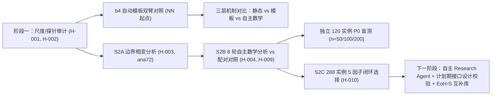
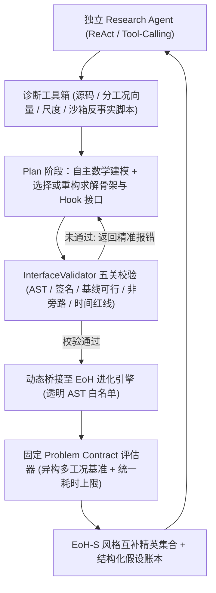

# auto-algo-opt 硕士中期研究综合报告（主分支合入里程碑）

> **日期**：2026-11-21　｜　**分支**：`main`（合入自 `feat/cvrp-midterm-research`）　｜　**主攻问题**：CVRP（保留 OBP / TSP 已有分支证据作补充）　｜　**模型**：`deepseek-flash`

---

## 1 · 执行摘要（Executive Summary）

本阶段围绕硕士学位论文中期核心任务，系统推进了**方向一（启发式规则的自主数学分析与迭代构造）**与**方向二（多规则性能互补与实例级算法选择）**两条研究主线，并通过多轮严格配对对照、反事实消融与独立多规模盲测完成阶段性收口并合并至主分支。

核心成果可概括为四点：

1. **三层递进对照证明“真实数学结构分析”是突破性能瓶颈的核心变量**：
   - **L1 静态提示（`a2–a5`，`NN` 起点）**：轮间提示逐字节恒定、跨批臂序反转，近 300 个候选无一超越冻结 `C`（`10.9197`）。
   - **L2 自动模板状态机（`b4_finding_only` vs 配对 `b4_control`，`NN` 起点，各 24 请求）**：消除尺度崩溃候选（`0` vs `3` 轮触发 `spread >= 5%`）并避免 3 轮停滞，以 **`11.4718`** 胜配对对照 **`11.8055`**（**`−2.83%`**），但因未剖析 CVRP 几何/容量数学机理，仍落后冻结 `C` `+5.06%`。
   - **L3 真实自主数学分析（`s2_autonomous_math_r8` vs 配对 `s2_control_r8`，强前沿 `[C, A, B, V0]` 起点，各 8 轮 / 48 请求）**：每轮基于源码审计、数学推导与反事实消融提出/证伪假设（`H-003`–`H-009`）。在 **120 个完全未见的多规模 P0 盲测实例（`n ∈ {50, 100, 200}`）**上，零泄露选出的新规则 **`s2_r5_spiral`** 取得 **`19.6092`**（`0.00%` 尺度极差），显著碾压同预算对照 **`+4.92%`（`p = 0.0000`, `109/120` 胜）**，并全面击败此前所有冻结规则（`+4.87%` 至 `+13.06%`，全 `p = 0.0000`）。
2. **发现 CVRP 构造启发式的精确相变与 4 项新算法机理**：
   - 证明线性打分 $s_\alpha(i,j)=d(i,j)-\alpha\,d(0,j)$ 在仓库出发步 $i=0$ 存在 **$\alpha=1$ 精确相变**（跨过 `0.99→1.01` 总路程不连续骤降 **`−6.82%`**，回程空驶占比由 `30.14%` 降至 `23.22%`）；仅替换冻结 `V0` 的出发步即在 120 盲测实例上提升 **`+7.96%` (`p = 0.0000`)**。
   - 经 8 轮迭代自主构造并验证了**无量纲主动早返仓（`return 0`）**、**三角伸长比 $\rho$**、**余弦角一致性 $\cos\theta_0$**、**纯状态由外向内螺旋 $\alpha_{\text{eff}}$** 与 **AST 安全孤立紧迫度**；同时完整留痕 **2 项被实验证伪并放弃的负假设**（`H-004a`、`H-008a`）与 **1 次沙箱故障自诊断恢复**（R6 `fill_diagonal` → R7 `np.where`）。
3. **方向一反哺方向二形成闭环突破，并揭示“规模收缩律”**：
   - 在 **288 实例 5 因子多规模测试床**（`n ∈ {50, 100, 200}` × 空间 × 仓库 × 容量 × 均匀/双峰需求，12 维特征 `0.484 ms`）中，单条自主构造规则 **`s2_r5_spiral`（总路程 `7211.13`）直接超越旧 8 规则池的事后全知 Oracle（`VBS_base = 7234.72`）**；`s2_r7_iso` 在 `clustered` 赢得最多单题冠军（`41/144`），形成新一代互补组合。
   - 揭示逐点规则的 **VBS–SBS 互补间隙随规模急剧收缩定律**（旧池 `3.92% → 1.73% → 0.76%`；扩容池 `4.69% → 1.87% → 0.49%`）。
   - 纯 NumPy 随机森林 `rf_reg` 在 `cv12` 上实现统计显著净收益 **`+0.28% [+0.08%, +0.49%], p = 0.0029`**（`n=50` 达 **`+1.14%`**），且含特征提取的平均净耗时 **`10.86 ms < SBS 10.92 ms`**。
4. **明确当前自动化框架的 4 大瓶颈，确立下一阶段（中期前两周）升级路线**：
   - 定位现有 `agent_skill_loop` 的核心短板（研究大脑未内生化、4 题小开发集过拟合、文字通道与隐藏 AST 白名单、固定 `select_next_node` 接口锁死范式上限导致仍落后并行 Clarke–Wright `+9.10%`），确立向 **独立 Research Agent + EoH-S 异构互补基准 + 计划期自主接口设计与五关校验器** 演进的清晰蓝图。

---

## 2 · 整体研究闭环与里程碑脉络

---

## 3 · 方向一：三层对照与自主数学分析实证

### 3.1 前置数学与代码审计（`H-001`、`H-003`）

| 审计主题 | 关键量化证据 | 机制结论 |
|---|---|---|
| **H-001：`Frozen C` 尺度坍塌机制**（`analysis/scale_term_audit.py`） | 全量 300 步精确复现 `C.py:35` 门控：门控率 `1.7%→67.7%→84.3%`；触发时 `cap_term/base` log-log 斜率 **−1.994 ≈ O(1/s²)**；消融极差：`C_full 206.99%`、`C_no_cap 0.18%`、`C_rel_band 0.40%`、`C_no_dem 205.89%` | **串联机制**：绝对 `band` 是门控开关，`cap_term`（$O(1/s^2)$）是破坏载荷；仅换相对宽度可止崩，但标称退步 `+1.92%` |
| **A.py 评分探针修正**（`analysis/score_probe.py`） | 捕获 `np.argsort` + 步内去均值固定效应回归：汇总 `r²=0.56353`，**步内 `r²_within_step = 0.999883`** | `A.py` 单步内 99.99% 线性等价于标准节约量，但在仓库起点 $i=0$ 代数退化为 `argmin(demand)` |
| **H-003：仓库出发相变**（`analysis/boundary_analysis.py`，72 实例 `ana72`） | `alpha` 跨过 `0.99→1.01` 总路程骤降 **`−6.82%`**（回程空驶 `30.14%→23.22%`）；**仅替换起点**使 `V0` 降 **`−8.29%`**（`20.30→18.61`）、`C` 降 **`−7.93%`**（`20.41→18.79`） | 起点与中程耦合是 `V0/C` 跨规模退化主因；`A vs B` 在聚类近满容桶分歧达 **47.30%**（均匀仅 28.40%） |

### 3.2 三层搜索机制配对总表

| 层级与机制 | 起点与预算 | 对照臂结果 | 实验臂结果 | 科学结论 |
|---|---|---|---|---|
| **L1：静态引导 `a2–a5`** | `NN (12.115)`；4 轮 / 24 请求 | `a5 Control`: `11.204` (`+2.60% vs C`) | 最佳 `a5 Finding`: `11.024` (`+0.95% vs C`)；`a2/a3` 与 `a5` 臂序反转 | 轮间文本恒定、`hypotheses` 恒空；0/300 候选胜 `C`；无稳定收益 |
| **L2：自动模板状态机 `b4`** | `NN (12.115)`；4 轮 / 24 请求 | **`b4_control`**：`11.8055` (`+8.11% vs C`)，R1 后停滞 3 轮，3 轮出现 `spread >= 5%` 候选 | **`b4_finding_only`**：`11.4718` (`+5.06% vs C`)，连涨 3 轮，0 尺度崩溃候选，胜对照 **`−2.83%`** | 模板状态机能消除尺度崩溃与停滞，但缺问题数学洞察，仍远低于 `C` |
| **L3：自主数学分析 `S2`** | 冻结 4 强 `[C, A, B, V0]`；8 轮 / 48 请求 | **`s2_control_r8`**：**0/33** 胜 `C`（最佳 `dev4 −9.03%`），反复尺度崩溃（spread 最高 `219.1%`） | **`s2_autonomous_math_r8`**：8 互异方向、8/8 非空假设、0 截断，**14+ 规则胜 `C`**（`sh6 10.2078` 较 `C` **−6.52%**） | 源码诊断 + 数学假设检验/证伪（放弃 `H-004a / H-008a` + 修复 R6 AST）带来质变突破 |

### 3.3 独立 120 实例多规模 P0 盲测（零泄露协议，10,000 次配对 Bootstrap）

| 规则 | 来源与零泄露口径 | 尺度极差 | `P0-50` | `P0-100` | `P0-200` | **`P0-120` 均值** |
|---|---|---:|---:|---:|---:|---:|
| *`cw_merge_ref`* | *非逐点并行 Clarke–Wright 合并参照* | *—* | *9.1593* | *15.4438* | *27.4678* | *17.3570* |
| **`s2_r5_spiral`** (`auto_ana1_r5`) | 自主数学分析（离线 `ana72` 第 1） | **0.00%** | **10.3864** | **17.6375** | **30.8038** | **19.6092** |
| `s2_r4_cos` (`auto_dev4_r4`) | 自主数学分析（R4 两阶段+余弦角） | **0.00%** | 10.6125 | 17.7483 | 31.0694 | 19.8100 |
| `s2_r7_iso` (`auto_dev3_r7`) | 自主数学分析（R7 AST 安全孤立紧迫） | **0.00%** | 10.6208 | 17.8546 | 31.1661 | 19.8805 |
| `V0_decoupled_theory` | H-003 仅替换 `V0` 出发步理论规则 | **0.00%** | 11.4556 | 18.4766 | 31.8920 | 20.6081 |
| `Frozen A` | 前期最佳泛化 PoC 规则 | 0.00% | 11.1348 | 18.6435 | 32.0615 | 20.6133 |
| **`ctrl_dev1_r7`** (`s2_ctrl_best`) | 同预算配对对照最优 | 0.00% | 11.3657 | 18.6716 | 31.8315 | **20.6229** |
| `Frozen B` / `savings` | 前期 PoC 规则 / 逐点节约量基线 | 0.00% | 11.56 / 11.58 | 18.73 / 18.77 | 32.50 / 32.51 | 20.93 / 20.95 |
| `auto_dev1_r3`（过拟合警示） | 仅凭 4 题 `dev4` 选第 1（漏写起点分支） | 0.00% | 10.9803 | 18.9545 | 33.4885 | 21.1411 |
| `Frozen V0` / `Frozen C` | 前期线性 / 小套件最优 PoC 规则 | 0.18% / **206.99%** | 11.53 / 11.58 | 20.18 / 20.18 | 35.46 / 35.90 | 22.39 / 22.55 |

- **`s2_r5_spiral` 盲测显著性**：胜同预算对照 **`+4.92% [+4.22%, +5.67%], p=0.0000`（`109/120` 胜）**；胜冻结 `A` **`+4.87%`（`104/120`）**、胜 `B` **`+6.31%`（`114/120`, `n=200` 全胜）**、胜 `savings` **`+6.41%`（`113/120`）**、胜 `C` **`+13.06%`（`116/120`）**。
- **诚实反面发现**：仅凭 4 实例 `dev4` 选优的 `auto_dev1_r3` 汇总反落后对照组 **`−2.51%`**，直接暴露极小单规模开发集筛选的过拟合陷阱。

---

## 4 · 方向二：多规模性能互补、算法选择与闭环效应

- **第一阶段（96 实例 `n=50` × 8 工况，v4）**：冻结 `A/B/C` 入池后互补间隙增至 **`4.09%`**（`A` 赢 `uniform` 3/4、`B` 赢 `clustered` 4/4）；1 特征 `cluster_stump_loo` 达 **`+0.93% [+0.07%, +1.81%], p=0.0163`**，打平 8 特征成对排序（`+0.94%`）；澄清预编译纯求解耗时 `b (1.089 ms) > c (1.016 ms) > a (0.869 ms) > savings (0.724 ms) > nn (0.590 ms)`。
- **第二阶段（288 实例 5 因子多规模：`n ∈ {50, 100, 200}` × 空间 × 仓库 × 容量 × 均匀/双峰需求 + 12 维特征 `0.484 ms` + `cw_merge` 参照 `22.95, 4.14 ms`）**：

| 候选池 / 规模子集 | VBS（全知最优） | SBS（固定最优） | SBS 规则 | SBS→VBS 间隙 | Oracle 胜场 Top 3 |
|---|---:|---:|---|---:|---|
| 旧 8 规则池 `pointwise_base`（288 例） | 7234.72 | 7347.51 | `savings` | 1.56% | `savings:127, b:59, a:50` |
| **闭环 12 规则池 `pointwise_plus_s2`（288 例）** | **7096.72** | **7211.13** | **`s2_r5_spiral`** | 1.61% | **`s2_r5_spiral:94, s2_r7_iso:68, savings:38`** |
| ├ `n = 50`（96 例，base → +S2） | 1177.59 → **1153.62** | 1223.75 → **1207.70** | `savings` → `s2_ctrl_best` | **3.92% → 4.69%** | `s2_r5_spiral:19, s2_ctrl_best:17, s2_r7_iso:16` |
| ├ `n = 100`（96 例，base → +S2） | 2125.47 → **2084.13** | 2162.20 → **2123.15** | `savings` → `s2_r5_spiral` | **1.73% → 1.87%** | `s2_r5_spiral:32, s2_r7_iso:24, savings:13` |
| └ `n = 200`（96 例，base → +S2） | 3931.67 → **3858.97** | 3961.55 → **3877.80** | `savings` → `s2_r5_spiral` | **0.76% → 0.49%** | **`s2_r5_spiral:43, s2_r7_iso:28`**（合占 74%） |

### 多协议折外选择器验证（`pointwise_plus_s2`，10,000 次 Bootstrap）

| 验证协议 | 模型 | 相对折内 SBS 增益 [95% CI] | `p_boot` | W/T/L | 含特征净耗时（SBS `10.92 ms`） |
|---|---|---|---:|---:|---:|
| **`cv12`（12 折多规模同分布）** | **`rf_reg`（纯 NumPy 随机森林）** | **`+0.28% [+0.08%, +0.49%]`**（`n=50: +1.14%`, `n=100: +0.30%`） | **0.0029** | **57/195/36** | **`10.86 ms`**（快于 SBS） |
| `cv12` | `pairwise_plain` | `+0.22% [-0.02%, +0.47%]` | 0.0398 | 71/156/61 | `10.49 ms` |
| `loro48`（留一工况） | `rf_reg` | `+0.08% [-0.13%, +0.29%]`（CI 跨 0） | 0.2277 | 45/205/38 | `10.83 ms` |
| `loso3`（留一规模外推） | `rf_reg` / `ridge` | `−0.11%` / `−0.22%`（不可零样本跨规模外推） | 0.81 / 0.92 | — | `10.35 / 11.48 ms` |

- **三大结构洞见**：① `s2_r5_spiral` 单规则超越旧 8 规则全知 Oracle，`s2_r7_iso` 拿下 `clustered` 最高胜场（`41/144`）；② **规模收缩律**界定算法选择的高收益窗口（中小规模高增益、大规模收敛至强单规则）；③ 新特征 `log_n / depot_angle_disp / nn_dist_cv` 占随机森林置换重要性前 6 中的 3 席。

---

## 5 · 现有框架瓶颈诊断与下一阶段（中期前两周）架构升级蓝图

| 现有瓶颈 | 实测暴露问题 | 下一阶段升级设计 |
|---|---|---|
| **1. 研究大脑未内生化** | `b4` 全自动但为死模板（`11.47`）；`S2` 成绩强但由外部 Coding Agent 轮间交互推动，且目前仅 1 组配对种子 | 构建独立 **`research_agent/`**（ReAct / Tool-Calling 循环），内建诊断工具箱与受限分析沙箱，实现端到端无人值守运行并补齐多随机种子 |
| **2. 开发基准过窄且单标量选优** | `cvrp_construct_mini` 仅 4 个 `n=50` 均匀实例，诱发 `auto_dev1_r3` 跨规模过拟合，无法保留跨分布专家 | 参考 **EoH-S** 接入分层异构多工况基准（输出分工况向量 + 尺度极差）与**互补精英集合管理（Complementary Archive）** |
| **3. 文本通道窄且 AST 白名单隐蔽** | `round_context.txt` 无硬约束；`_NUMPY_ATTRIBUTES` 隐藏禁调 `fill_diagonal / ix_ / searchsorted`，R6 整轮全军覆没 | 提示词透明注入允许/禁用函数清单，结构化诊断直连 Agent 决策 |
| **4. 固定问题接口锁死范式上限（核心）** | `select_next_node(...)` 锁死单车顺序构造，仍落后并行 `cw_merge` `+9.10%` | **两层解耦架构**：底层仅固定问题可行解与耗时红线（`solve_cvrp -> routes`），上层允许 Agent 在 `plan` 阶段**自主设计求解骨架与可进化 Hook 接口**，经 **5 关 `InterfaceValidator`**（AST 安全、签名一致、基线可行、Hook 非旁路、时间上限）校验后动态载入 EoH 进化 |

---

## 6 · 仓库资产与验证状态索引

- **核心报告**：[`REPORT_MIDTERM_SYNTHESIS.md`](REPORT_MIDTERM_SYNTHESIS.md)、[`REPORT_20261121.md`](REPORT_20261121.md)、[`REPORT_STAGE2.md`](REPORT_STAGE2.md)、[`HANDOVER_20261121.md`](HANDOVER_20261121.md)、[`REVIEW_RESPONSE_r4.md`](REVIEW_RESPONSE_r4.md)、[`REVIEW_RESPONSE_r5.md`](REVIEW_RESPONSE_r5.md)
- **假设账本**：[`ledger/hypotheses.jsonl`](ledger/hypotheses.jsonl)（`H-001` 至 `H-010` 完整留痕）
- **全部 8 张经自动化校验的 SVG 图表**：[`analysis/figures/`](analysis/figures/)（4 张，`check_figures.py` `ok`）、[`analysis/figures_s2/`](analysis/figures_s2/)（4 张，`check_figures_s2.py` `ok`）
- **合约与冻结资产检查**：`tests/kernel/test_session_contracts.py` 与 `tests/kernel/test_session_phases.py` **24 passed**；`runs/round_activity.py --selftest` **ok**；`reports/evidence/cvrp_p0_p1_p2_20261107/` 与 `eoh_frozen/` 零改动。
