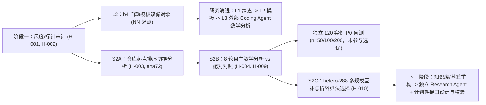

# auto-algo-opt 硕士中期研究综合报告（审计修订版）

> **日期**：2026-11-21　｜　**分支**：`main`（离线审计复验基线 `984a141` / `b8c579b`）　｜　**主攻问题**：CVRP（保留 OBP / TSP 已有证据作补充）　｜　**搜索生成模型**：`deepseek-flash`

---

## 1 · 执行摘要（Executive Summary）

我们研究了如何利用可执行的数学诊断改进 CVRP 构造规则。由仓库起点的排序切换出发，固定冻结规则 `V0` 的中程打分、仅替换仓库出发步，独立盲测集 **`P0-120`** 总路程降低 **`7.96%`**（95% 配对 Bootstrap 区间 `[6.88%, 8.98%]`，10,000 次重采样中 0 次得到非正收益，`94/120` 胜）。在一次配对搜索中，按独立离线开发分析集 **`ana72`** 选出的 R5 规则（`s2_r5_spiral`）较同请求上限（48 次 EoH 请求）的中性对照最优规则（`ctrl_dev1_r7`）缩短 `P0-120` 总路程 **`4.92%`**，95% 配对 Bootstrap 区间为 `[4.22%, 5.67%]`，10,000 次重采样中 0 次得到非正收益，在 120 个实例中胜出 **109 次**（按规模分层：`n=50` 降 `8.62%`、`n=100` 降 `5.54%`、`n=200` 降 `3.23%`；若另以逐实例相对降幅的均值衡量，复算为 `5.66%`）。R5 在 288 实例 5 因子异构测试矩阵（`hetero-288`）上的总路程（`7211.13`）低于旧 8 规则候选池的逐实例最优总路程（`7234.72`）。在 `hetero-288` 闭环 12 规则池上，实例级选择（`rf_reg`）在同分布 12 折交叉验证（`cv12`）取得 **`+0.28%` `[0.08%, 0.49%]`** 的折外质量增益，但在留一工况（`loro48`: `+0.08% [−0.13%, +0.29%]`）和留一规模（`loso3`: `−0.11%`）下没有观察到稳定收益；同时在分离计时口径下，选择器包含特征提取与单实例推理后总耗时高于固定单一最优规则。

本报告同步纳入了针对 `b4` 与 `S2` 历史运行的离线复验结果（[`analysis/audit_reverification_p0.json`](analysis/audit_reverification_p0.json)、[`analysis/audit_reverification_p1.json`](analysis/audit_reverification_p1.json)），所有百分比均明确比较对象与分母方向，并将基于固定候选的逐实例重采样不确定性与多次搜索运行的稳定性严格区分。

---

## 2 · 整体研究闭环与里程碑脉络

---

## 3 · 方向一：数学机理证据、三层演进对照与独立盲测

### 3.1 前置数学与代码审计（`H-001`、`H-003`）

| 审计主题 | 关键量化证据（明确套件与比较方向） | 机制结论与适用边界 |
|---|---|---|
| **H-001：`Frozen C` 尺度敏感机制**（[`analysis/scale_term_audit.py`](analysis/scale_term_audit.py)） | 全量 300 步复现 `C.py:35` 门控：门控触发率随坐标缩放从 `1.7% → 67.7% → 84.3%`；触发时 `cap_term/base` 的 log-log 斜率为 **−1.994 ≈ O(1/s²)**；共享 6 例 4 尺度极差：`C_full 206.99%`、`C_no_cap 0.18%`、`C_rel_band 0.40%`、`C_no_dem 205.89%` | **串联机制**：绝对 `band` 是门控开关，`cap_term`（$O(1/s^2)$）是破坏载荷；仅换相对宽度可压低尺度极差，但在标称尺度路程较 `C_full` 增长 `+1.92%` |
| **A.py 评分探针修正**（[`analysis/score_probe.py`](analysis/score_probe.py)） | 捕获 `np.argsort` 并采用步内去均值固定效应回归：汇总 $r^2=0.56353$，**步内 $r^2_{\text{within\_step}} = 0.999883$** | `A.py` 单步内几乎线性等价于标准节约量，但在仓库起点 $i=0$ 处主项抵消，退化为 `argmin(demand)` |
| **H-003：仓库起点排序切换**（[`analysis/boundary_analysis.py`](analysis/boundary_analysis.py)，`ana72` 72 实例） | 线性打分 $s_\alpha(i,j)=d(i,j)-\alpha\,d(0,j)$ 在仓库出发步 $i=0$ 化为 $s_\alpha(0,j)=(1-\alpha)\,d(0,j)$，最小化排序在 **$\alpha=1$** 处发生切换（$\alpha=1$ 等号由破平规则决定）。在 `ana72` 上纯距离打分扫描跨过 `0.99 → 1.01` 时均值由 **`20.3165 → 18.9302`**（缩短 `6.82%`，回程空驶占比 `30.14% → 23.22%`）；仅替换 `i=0` 出发步为 `heavy_far` 时，`V0` 在 `ana72` 由 `20.2959 → 18.6124`（缩短 `8.29%`）、`C` 由 `20.4104 → 18.7909`（缩短 `7.93%`）；在独立盲测 `P0-120` 上，固定 `V0` 中程规则仅替换出发步（`V0_decoupled_theory`）使总路程由 `22.3910 → 20.6081`（**降低 `7.96%`，95% Bootstrap CI `[6.88%, 8.98%]`，10,000 次重采样 0 次非正，`94/120` 胜**） | 仓库出发步与中程打分耦合是 `V0/C` 在多规模下退化的主要原因；`20.3165 → 18.9302` 是 `ana72` 这组实例上的纯距离扫描路程结果；分容量桶追踪另显示 `A vs B` 在聚类近满容桶分歧率达 **47.30%**（均匀为 `28.40%`） |

### 3.2 搜索过程与三层研究演进（各层仅由本层配对对照支持）

我们将 **L1 静态文字提示（`a2–a5`）**、**L2 自动模板反馈（`b4`）** 与 **L3 外部 Coding Agent 轮间数学分析（`S2`）** 呈现为递进的研究演进；由于起点种子、轮数与外部参与方式不同，**每层结论仅由本层同起点、同请求上限的配对对照支撑**。

- **开发诊断套件定位**：下表中的共享 6 例（`shared_diagnostic_6`，`C = 10.9197`）包含搜索期使用的全部 4 个 `dev4` 实例（`cvrp_construct_mini`）及 2 例补充实例，**定位为搜索期开发诊断**，不作为独立盲测依据。
- **离线复验与请求/Token 对账**（[`audit_reverification_p0.json`](analysis/audit_reverification_p0.json)、[`audit_reverification_p1.json`](analysis/audit_reverification_p1.json)）：
  - SQLite 会话账本只读核对显示，`b4_control`、`b4_finding_only`、`s2_control_r8`、`s2_autonomous_math_r8` 四场历史运行分别记录 **`24`、`24`、`48`、`48` 次已完成请求**（0 失败、0 结果未知、0 用量未知，每轮 1 个执行任务）。
  - 在 `S2` 中，两臂各使用 **48 次 EoH 请求**；实验臂已记录的输入加输出 Token 总量为 `198,368 + 38,869 = 237,237`，对照臂为 `152,311 + 23,364 = 175,675`，实验臂 EoH Token 约多 **`35.0%`**，且**外部 Coding Agent 的轮间分析推理成本单列，不计入 EoH 请求数**。
  - 修正探针主动回仓语义并与 `agent_skill_loop/evaluator.py` 对齐后，共享 6 例上 `C`、`R3 (10.3051)`、`R4 (10.2078)`、`R5 (10.2714，含 17 次合法主动早返仓)`、`R7 (10.2595)` 及对照最优规则与正式评测的逐实例绝对误差均为 **`0.0`**；`a5` 四臂加 `b4` 两臂共 24 个逐轮最好值全部复核一致。

| 研究层级 | 起点与配对预算 | 对照臂过程与共享 6 例诊断 | 实验臂过程与共享 6 例诊断 | 本层配对结论（按复验口径） |
|---|---|---|---|---|
| **L1：静态文字引导（`a2–a5`）** | `NN (12.1150)`；4 轮 / 24 EoH 请求 | `a5_control`: 共享 6 例最优 `11.2041`（较 `C` 高 `+2.60%`） | `a5_finding_only`: 共享 6 例最优 `11.0238`（较 `C` 高 `+0.95%`）；`a2/a3` 与 `a5` 臂序反转 | 轮间 `research_finding` 静态不变，跨批臂序不稳定，未出现优于 `C (10.9197)` 的候选 |
| **L2：自动模板反馈（`b4`）** | `NN (12.1150)`；4 轮 / 24 EoH 请求（单 seed） | **`b4_control`**：共享 6 例最优 **`11.8055`**（较 `C` 高 `+8.11%`），R1 后连续 3 轮停滞；20 个生成候选均正式有效，其中 3 轮出现 `spread >= 5%` 候选（共 5 个），跨轮精确代码重复 0 个 | **`b4_finding_only`**：共享 6 例最优 **`11.4718`**（相对配对 `b4_control` 缩短 **`2.83%`**；较 `C` 高 **`+5.06%`**），逐轮改善（`12.0292 → 11.6784 → 11.5050 → 11.4718`）。离线复验：20 个生成候选中 **2 个被正式评测拒绝**（R2 `candidate_2: count_nonzero`、R3 `candidate_4: ix_`），余 18 个正式有效且无 `spread >= 5%`、无跨轮精确代码重复；提示字段审计显示 4 轮均写入 `research_finding` 且数值更新，但**去除数字后第 2–4 轮 `decision_summary` 共用同一建议模板**（4 轮共 2 个模板） | 在配对试验中较对照缩短 `2.83%` 且未在已通过正式评测的生成候选中出现高尺度漂移；但后 3 轮建议模板重复、缺少问题数学结构剖析，仍落后 `C` `+5.06%` |
| **L3：外部 Coding Agent 数学分析（`S2`）** | 冻结 4 规则 `[C, A, B, V0]`；各 8 轮 / 48 EoH 请求（单 seed；实验臂 EoH Token 多 ~35%，另含外部分析成本） | **`s2_control_r8`**：33 个有效不重复生成候选中 **0 个** 在 `dev4` 胜 `C`（最佳 `dev4 −9.03%`，共享 6 例 `11.1069`）；多次产出尺度敏感候选（极差最高 `219.1%`） | **`s2_autonomous_math_r8`**：8 轮 8 组不同 `decision_summary` 模板（0 截断），共 32 个有效不重复生成候选（含 2 次证伪放弃 `H-004a / H-008a` 与 R6 AST 拒绝 `5/5` → R7 恢复），共享 6 例出现多条低于 `C (10.9197)` 的规则：**`R4 = 10.2078`、`R7 = 10.2595`、`R5 = 10.2714`（17 次主动回仓）、`R3 = 10.3051`** | 外部 Coding Agent 的源码审计与假设检验/证伪在共享 6 例与独立盲测 `P0-120` 上均取得显著增益；当前为单次配对搜索，多运行稳定性待补测 |

### 3.3 独立 120 实例多规模 `P0-120` 盲测（规则按 `dev4` 或 `ana72` 选优，P0 未参与选择）

盲测集为只读冻结的 `reports/evidence/cvrp_p0_p1_p2_20261107/p0/suite_{50,100,200}.json`（每规模 40 例，共 120 例；汇总脚本 [`analysis/eval_s2_holdout.py`](analysis/eval_s2_holdout.py)）。**以下配对 Bootstrap 反映固定候选规则在 120 个测试实例上逐实例重采样的不确定性，而非多次独立搜索运行的方差。**

| 规则 | 来源与选优口径（P0 未参与） | 4 尺度极差 | `P0-50` | `P0-100` | `P0-200` | **`P0-120` 均值** |
|---|---|---:|---:|---:|---:|---:|
| *`cw_merge_ref`* | *已评估的非逐点并行 Clarke–Wright 合并参照* | *—* | *9.1593* | *15.4438* | *27.4678* | *17.3570* |
| **`s2_r5_spiral`** (`auto_ana1_r5`) | 外部数学分析搜索（按 `ana72` 选第 1） | **0.00%** | **10.3864** | **17.6375** | **30.8038** | **19.6092** |
| `s2_r4_cos` (`auto_dev4_r4`) | 外部数学分析搜索（R4 两阶段+余弦角） | **0.00%** | 10.6125 | 17.7483 | 31.0694 | 19.8100 |
| `s2_r7_iso` (`auto_dev3_r7`) | 外部数学分析搜索（R7 AST 安全孤立紧迫） | **0.00%** | 10.6208 | 17.8546 | 31.1661 | 19.8805 |
| `V0_decoupled_theory` | H-003 固定 `V0` 中程、仅替换出发步 | **0.00%** | 11.4556 | 18.4766 | 31.8920 | 20.6081 |
| `Frozen A` | 前期泛化 PoC 规则 | 0.00% | 11.1348 | 18.6435 | 32.0615 | 20.6133 |
| **`ctrl_dev1_r7`** (`s2_ctrl_best`) | 同请求上限配对对照（`dev4`/`ana72` 均第 1） | 0.00% | 11.3657 | 18.6716 | 31.8315 | **20.6229** |
| `Frozen B` / `savings` | 前期 PoC 规则 / 逐点节约量基线 | 0.00% | 11.56 / 11.58 | 18.73 / 18.77 | 32.50 / 32.51 | 20.93 / 20.95 |
| `auto_dev1_r3`（反例：仅按 `dev4` 选） | 仅按 4 例 `dev4` 选第 1（漏写起点分支） | 0.00% | 10.9803 | 18.9545 | 33.4885 | 21.1411 |
| `Frozen V0` / `Frozen C` | 前期线性 / 小套件最优 PoC 规则 | 0.18% / **206.99%** | 11.53 / 11.58 | 20.18 / 20.18 | 35.46 / 35.90 | 22.39 / 22.55 |

- **核心指标与分母口径（总路程降幅 = `(基线总长 − 候选总长) / 基线总长`）**：
  - **`s2_r5_spiral` 相对配对对照 `ctrl_dev1_r7`**：`P0-120` 总路程降低 **`4.92%`**，95% 配对 Bootstrap 区间 **`[4.22%, 5.67%]`**，**10,000 次 Bootstrap 中 0 次得到非正收益**，胜/平/负 **`109/0/11`**；分层降幅为 `n=50` **`8.62%`**（`35/40` 胜）、`n=100` **`5.54%`**（`36/40` 胜）、`n=200` **`3.23%`**（`38/40` 胜）。如另补报**逐实例相对降幅的均值**（不同聚合指标，小规模权重更高），复算为 **`5.66%`**。
  - **`s2_r5_spiral` 相对其他逐点基线（`P0-120` 总路程降幅，10,000 次 Bootstrap 均 0 次非正）**：相对 `Frozen A` 降低 `4.87%`（`104/120` 胜）、相对 `Frozen B` 降低 `6.31%`（`114/120` 胜，`n=200` `40/40`）、相对 `savings` 降低 `6.41%`（`113/120` 胜）、相对 `Frozen C` 降低 `13.06%`（`116/120` 胜）。
  - **多组件归因说明**：R5 的无量纲两阶段出发步、纯状态内旋 $\alpha_{\text{eff}}$、三角伸长比 $\rho$、余弦角项 $\cos\theta_0$ 与自适应早返仓共同生效；当前逐项贡献依据已有单步与轮间消融证据（`H-003`–`H-007`）陈述，尚未做全因子子集拆解。
  - **与并行合并参照 `cw_merge` 的比较**：在 **`P0-120`** 上 `cw_merge` 均值为 `17.3570`、`R5` 为 `19.6092`——**以 `CW` 为分母，`R5` 长 `12.98%`**；**以 `R5` 为分母，`CW` 短 `11.49%`**。在 **`hetero-288`** 上 `cw_merge` 为 `22.9498`、`R5` 为 `25.0387`（以 `CW` 为分母 `R5` 长 **`9.10%`**）。结论表述为：**已评估的并行合并参照领先当前逐点规则**。
  - **过拟合反例**：仅凭 4 例 `dev4` 选优的 `auto_dev1_r3` 在 `P0-120` 总路程反落后配对对照 **`2.51%`**（`−2.51%`，`45/120` 胜），说明极小单规模开发集不足以支撑跨规模选优。

---

## 4 · 方向二：多规模性能互补、折外算法选择与计时修正

- **第一阶段（96 实例 `n=50` × 8 工况，v4）**：冻结 `A/B/C` 入池后互补间隙为 **`4.09%`**（`A` 赢 `uniform` 3/4、`B` 赢 `clustered` 4/4）；1 特征 `cluster_stump_loo` 取得 **`+0.93% [+0.07%, +1.81%]`**（`p_boot = 0.0163`），与 8 特征成对排序（`+0.94%`）持平；预编译纯求解耗时 `b (1.089 ms) > c (1.016 ms) > a (0.869 ms) > savings (0.724 ms) > nn (0.590 ms)`。
- **第二阶段（`hetero-288`：288 实例 5 因子多规模：`n ∈ {50, 100, 200}` × 空间 × 仓库 × 容量 × 均匀/双峰需求 + 12 维特征 `0.484 ms` + `cw_merge` 参照 `22.9498`）**：

| 候选池 / 规模子集 | VBS（逐实例最优） | SBS（固定单一最优） | SBS 规则 | SBS→VBS 互补间隙（`(SBS−VBS)/VBS`） | Oracle 胜场 Top 3 |
|---|---:|---:|---|---:|---|
| 旧 8 规则池 `pointwise_base`（288 例） | 7234.72 | 7347.51 | `savings` | 1.56% | `savings:127, b:59, a:50` |
| **扩充 12 规则池 `pointwise_plus_s2`（288 例）** | **7096.72** | **7211.13** | **`s2_r5_spiral`** | 1.61% | **`s2_r5_spiral:94, s2_r7_iso:68, savings:38`** |
| ├ `n = 50`（96 例，base → +S2） | 1177.59 → 1153.62 | 1223.75 → 1207.70 | `savings` → `s2_ctrl_best` | **3.92% → 4.69%** | `s2_r5_spiral:19, s2_ctrl_best:17, s2_r7_iso:16` |
| ├ `n = 100`（96 例，base → +S2） | 2125.47 → 2084.13 | 2162.20 → 2123.15 | `savings` → `s2_r5_spiral` | **1.73% → 1.87%** | `s2_r5_spiral:32, s2_r7_iso:24, savings:13` |
| └ `n = 200`（96 例，base → +S2） | 3931.67 → 3858.97 | 3961.55 → 3877.80 | `savings` → `s2_r5_spiral` | **0.76% → 0.49%** | `s2_r5_spiral:43, s2_r7_iso:28`（合占 74%） |

- **结构观察（严格口径）**：
  1. 单条自主构造规则 **`s2_r5_spiral` 的总路程（`7211.13`）低于旧 8 规则池的逐实例最优总路程（`VBS_base = 7234.72`）**；需说明扩大候选池时 `VBS_plus <= VBS_base` 的单调性由定义保证，真正非平凡的事实是单规则 `SBS_plus < VBS_base`，且 `s2_r7_iso` 在 `clustered` 子集取得最高单题胜场（`41/144`）。
  2. **在所测实例分布及规则池中，互补间隙随规模增长而收窄**（旧池 `3.92% → 1.73% → 0.76%`；扩充池 `4.69% → 1.87% → 0.49%`）。

### 多协议折外选择器验证与分离计时表（`pointwise_plus_s2`，10,000 次配对 Bootstrap，见 [`selection_s2/selectors_s2.json`](selection_s2/selectors_s2.json)）

> **计时口径说明（已更正原“RF 更快”误判）**：固定 SBS 不提取特征、不做模型推理，只计所运行算法耗时（**`10.436 ms`**）；选择器分别记录特征提取（`0.484 ms`）、单实例推理（`infer_ms`）与所选算法评测耗时（`solve_ms`）。旧日志未计入 `infer_ms` 且误将 `0.484 ms` 特征耗时加到固定 SBS（写成 `10.920 ms`），由此误将 `rf_reg` 的 `10.864 ms`（仅特征加算法评测时间）判为“更快”。此外，逐点规则的 `solve_ms` 采自 `agent_skill_loop/evaluator.py` 现有评测包装（含逐步复制与比对距离矩阵开销），与 `cw_merge`（`4.14 ms`）的耗时比较仅代表当前评测包装下的读数，非统一计时边界下的端到端速度结论。

| 验证协议 | 模型 | 相对折内 SBS 质量增益 [95% CI] | `p_boot` | W/T/L | 特征 (ms) | 推理 (ms) | 所选算法评测 (ms) | **总耗时 (ms)** |
|---|---|---|---:|---:|---:|---:|---:|---:|
| *基线（固定 SBS）* | *`fixed_best_sbs` (`s2_r5_spiral`)* | *0.00%* | *—* | *0/288/0* | *0.000* | *0.000* | *10.436* | ***10.436*** |
| **`cv12`（12 折同分布）** | **`rf_reg`（纯 NumPy 随机森林）** | **`+0.28% [+0.08%, +0.49%]`**（`n=50: +1.14%`, `n=100: +0.30%`, `n=200: −0.004%`） | **0.0029** | **57/195/36** | 0.484 | 0.076 | 10.380 | **10.940**（旧口径特征+算法 `10.864`） |
| `cv12` | `pairwise_plain` | `+0.22% [−0.02%, +0.47%]` | 0.0398 | 71/156/61 | 0.484 | 0.233 | 10.007 | 10.724 |
| `loro48`（留一工况） | `rf_reg` | `+0.08% [−0.13%, +0.29%]`（区间跨零） | 0.2277 | 45/205/38 | 0.484 | 0.099 | 10.347 | 10.929 |
| `loso3`（留一规模） | `rf_reg` / `ridge` | `−0.11% [−0.33%, +0.13%]` / `−0.22% [−0.52%, +0.09%]` | 0.81 / 0.92 | 58/174/56 | 0.484 | 0.087 / 0.005 | 9.866 / 10.995 | 10.437 / 11.484 |

---

## 5 · 现有框架瓶颈诊断与下一阶段架构升级蓝图

| 现有瓶颈 | 实测暴露问题 | 下一阶段升级设计 |
|---|---|---|
| **1. 研究大脑未内生化与单次运行边界** | `b4` 自动但后 3 轮建议模板重复；`S2` 由外部 Coding Agent 轮间推动且为单随机种子 | 构建独立 **`research_agent/`**（ReAct / Tool-Calling 循环），内建诊断工具箱与受限分析沙箱，实现端到端无人值守运行并补齐多随机种子复现 |
| **2. 开发基准过窄且单标量选优** | `cvrp_construct_mini` 仅 4 例 `n=50` 均匀实例，诱发 `auto_dev1_r3` 在 `P0-120` 落后对照 `2.51%` | 参考 **EoH-S** 重构分层异构多工况基准（纳入 CVRPLib 标准算例与多分布开发/验证/锁死盲测集）及互补精英库管理 |
| **3. 文本通道窄且 AST 白名单隐蔽** | `round_context.txt` 无硬约束；隐蔽禁调 `fill_diagonal / ix_ / count_nonzero` 导致 `b4` 2 例与 `S2` R6 整轮被拒 | 提示词透明注入机器派生的允许/禁用函数清单，结构化诊断直连 Agent 决策 |
| **4. 固定问题接口限制算法范式** | `select_next_node` 锁死单车顺序构造，在 `P0-120` 上较并行 `cw_merge` 长 `12.98%`（`hetero-288` 长 `9.10%`） | **两层解耦架构**：底层固定问题级可行解与耗时契约，上层允许 Agent 在 `plan` 阶段自主设计求解骨架与可进化 Hook 接口，经多关 `InterfaceValidator` 校验后动态进化 |

---

## 6 · 仓库资产、离线复验与验证索引

- **核心报告**：[`REPORT_MIDTERM_SYNTHESIS.md`](REPORT_MIDTERM_SYNTHESIS.md)、[`REPORT_20261121.md`](REPORT_20261121.md)、[`REPORT_STAGE2.md`](REPORT_STAGE2.md)、[`HANDOVER_20261121.md`](HANDOVER_20261121.md)、[`REVIEW_RESPONSE_r4.md`](REVIEW_RESPONSE_r4.md)、[`REVIEW_RESPONSE_r5.md`](REVIEW_RESPONSE_r5.md)
- **离线审计复验产物（原历史运行目录只读未改）**：[`analysis/audit_reverification_p0.json`](analysis/audit_reverification_p0.json)、[`analysis/audit_reverification_p1.json`](analysis/audit_reverification_p1.json)、[`analysis/reverification/`](analysis/reverification/)、[`selection_s2/selectors_s2.json`](selection_s2/selectors_s2.json)
- **假设账本与 SVG 图表**：[`ledger/hypotheses.jsonl`](ledger/hypotheses.jsonl)（`H-001`–`H-010`）、[`analysis/figures/`](analysis/figures/)（4 张）、[`analysis/figures_s2/`](analysis/figures_s2/)（4 张）
- **知识库与基准入口文档**：[`docs/knowledge_base.md`](../../docs/knowledge_base.md)（增量发布 `20261121-main-audit-kb-v1`，含 `evidence-cvrp-depot-start-phase-h003` 与 `method-cvrp-s2-r5-spiral`，历史 `v0` 逐字节保持不变）、[`docs/benchmarks_and_problems.md`](../../docs/benchmarks_and_problems.md)
